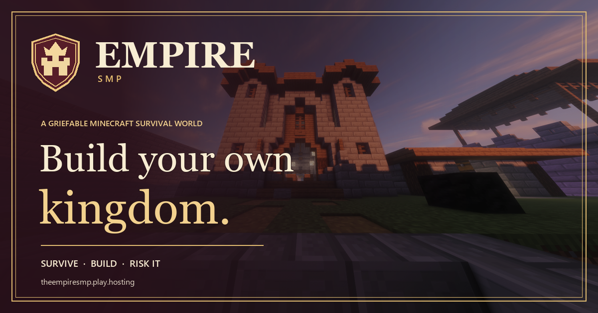

<div align="center">

# 🏰 The Empire SMP

**Build your own kingdom.**

The official website for The Empire, a griefable Minecraft survival server.<br>
Find your ground, make your mark, and decide what is worth defending.

[](https://empiresmp.pages.dev)
[](https://discord.gg/r8Tp55WBbS)




</div>

---

## 📑 Contents

- [Join the realm](#-join-the-realm)
- [What is The Empire?](#-what-is-the-empire)
- [What's on the website](#-whats-on-the-website)
- [Tech stack](#-tech-stack)
- [Running it locally](#-running-it-locally)
- [Project structure](#-project-structure)
- [How the live player count works](#-how-the-live-player-count-works)
- [Deployment](#-deployment)
- [Contributing](#-contributing)

---

## ⚔️ Join the realm

| | |
|---|---|
| **Server address** | `theempiresmp.play.hosting` |
| **Edition** | Minecraft Java Edition 1.8 – 26.3 |
| **No account or launcher?** | Play in your browser with Eaglercraft at [eymenwsmc.site](https://eymenwsmc.site/) |
| **Community** | [Empire SMP Discord](https://discord.gg/r8Tp55WBbS) |

Add the address to your Minecraft server list and you're in. If you don't own Minecraft or don't have a launcher, the browser version works on Eaglercraft 26.2 and 26.3 without any download.

---

## 👑 What is The Empire?

Empire is a shared survival world with no preset kingdom and no story handed down. It starts with a patch of wilderness and a few tools. What comes next is up to you.

- **Take root.** Find land beyond the beaten path, gather what you need, and build your first shelter.
- **Raise your banner.** Turn a refuge into a homestead and a homestead into a town. Invite allies and put yourself on the map.
- **Make your name.** Trade, bargain, explore, compete, or write your own laws. The realm grows through the choices players make together.

### A realm with real stakes

Empire is **griefable**. There are no grief protections, so builds and belongings can be raided, damaged, or taken. That risk is part of the world:

- **Your walls can fall.** Choose your ground carefully.
- **Trust is part of the game.** Allies can make a town stronger, and rivalries can redraw its borders.
- **The world belongs to its players.** There's room for builders, explorers, traders, tacticians, and troublemakers. Play your way, and leave space for others to do the same.

---

## 🗺️ What's on the website

The site is a single page that walks a new player from first impression to joining the server:

1. **The keep:** a hero section with the live player count, a one-click copy of the server IP, and links to Discord and browser play.
2. **The world:** what Empire is and why players come here.
3. **Your journey:** how a player grows from their first night to a legend.
4. **The charter:** the server's ground rules and what a griefable world means.
5. **Before you join:** what to expect, how to connect, and how to play in a browser without an account.
6. **FAQ:** quick answers about griefing, versions, and joining.

It also ships with SEO basics out of the box: Open Graph / Twitter card metadata, a generated `sitemap.xml`, and `robots.txt`.

---

## 🛠️ Tech stack

| Layer | Tool |
|---|---|
| Framework | [Next.js 16](https://nextjs.org/) (App Router, static export) |
| UI | [React 19](https://react.dev/) + plain CSS (`app/globals.css`) |
| Language | TypeScript |
| Hosting | [Cloudflare Pages](https://pages.cloudflare.com/) |
| Live data | Cloudflare Pages Function (`functions/api/players.ts`) |

The whole site is pre-rendered to static HTML at build time (`output: "export"`), so there's no Node server running in production. The only dynamic piece is the tiny serverless function that serves the player count.

---

## 💻 Running it locally

### Prerequisites

- **[Node.js](https://nodejs.org/) 22 or newer** (pinned in `.node-version`)
- **npm** (comes with Node)
- **Git**

### Setup

```bash
# 1. Clone the repo
git clone https://github.com/RonakChavda-Dev/empire-smp-website.git
cd empire-smp-website

# 2. Install dependencies
npm install

# 3. Start the dev server
npm run dev
```

Then open **[http://localhost:3000](http://localhost:3000)** in your browser. The page hot-reloads as you edit files in `app/`.

`npm run dev` actually starts two things at once:

- the **Next.js dev server** on port `3000`
- a small **local player-count proxy** on `http://127.0.0.1:8788/api/players`, which stands in for the Cloudflare function so the live player count works during development

Press `Ctrl + C` to stop both. Any extra flags are passed through to Next.js, e.g. `npm run dev -- --port 4000`.

> **Tip:** If you see `Could not start the local player-status proxy`, something else is already using port `8788`. Close it and try again.

### Building for production

```bash
npm run build
```

This creates a fully static site in the `out/` folder. To preview it locally, serve that folder with any static file server, for example:

```bash
npx serve out
```

> The live player count calls `/api/players`, which only exists when running under `npm run dev` or on Cloudflare Pages. When previewing `out/` with a plain static server, the rest of the site works but the player count won't load.

### Available scripts

| Command | What it does |
|---|---|
| `npm run dev` | Starts the dev server and the local player-count proxy |
| `npm run build` | Builds the static site into `out/` |

### Environment variables

| Variable | Required | Default | Purpose |
|---|---|---|---|
| `NEXT_PUBLIC_SITE_URL` | No | `https://empiresmp.pages.dev` | The canonical site URL, used for metadata, `sitemap.xml`, and `robots.txt`. Set it if you deploy to a custom domain. |

---

## 📁 Project structure

```
.
├── app/                     # Next.js App Router
│   ├── components/          # Page sections and UI pieces
│   │   ├── BrowserPlay.tsx      # Eaglercraft browser-play callout
│   │   ├── EmpireMark.tsx       # Logo mark
│   │   ├── Faq.tsx              # FAQ accordion
│   │   ├── GameplayPath.tsx     # "Your journey" section
│   │   ├── JoinActions.tsx      # Copy-IP / Discord buttons
│   │   ├── JoinSection.tsx      # "Before you join" section
│   │   ├── LoadingScreen.tsx    # Intro loading screen
│   │   ├── Reveal.tsx           # Scroll-reveal animation wrapper
│   │   ├── ServerCode.tsx       # Server address display
│   │   ├── ServerPresence.tsx   # Live player count
│   │   └── SiteHeader.tsx       # Top navigation
│   ├── lib/site.ts          # Site URL + shared links
│   ├── globals.css          # All site styles
│   ├── layout.tsx           # Root layout + SEO metadata
│   ├── page.tsx             # The home page
│   ├── icon.svg             # Favicon
│   ├── robots.ts            # Generates robots.txt
│   └── sitemap.ts           # Generates sitemap.xml
├── functions/
│   └── api/players.ts       # Cloudflare Pages Function: live player count
├── lib/
│   └── player-count.mjs     # Shared parser for the status response
├── public/                  # Static assets (castle art, social card)
├── scripts/
│   ├── dev.mjs              # Runs Next.js + the local player-count proxy
│   └── create_social_card.py# Regenerates public/og-image.png
├── next.config.ts
├── package.json
└── tsconfig.json
```

---

## 📡 How the live player count works

```
Browser ──► /api/players ──► status source ──► { "online": 4, "max": 20 }
```

1. `ServerPresence.tsx` requests the player count when the page loads, then refreshes it every 30 seconds.
2. In production that request hits `/api/players`, a [Cloudflare Pages Function](https://developers.cloudflare.com/pages/functions/) in `functions/api/players.ts`. In development it goes to the local proxy in `scripts/dev.mjs` on port `8788` instead.
3. Both fetch the server's status from an upstream status endpoint and run it through `lib/player-count.mjs`, which is forgiving about the format. It understands JSON with keys like `online`, `players`, or `maxPlayers`, as well as plain text like `4/20` or `online: 4`.
4. The result is returned as `{ "online": number, "max"?: number }`. If the status source is down, the endpoint responds with a `502` and the site shows the last known count (or "Player count unavailable") instead of breaking.

Going through a function (instead of calling the status source straight from the browser) avoids CORS problems and keeps the upstream URL in one place.

---

## 🚀 Deployment

The site is deployed on **Cloudflare Pages**. To set up your own deployment:

1. Push the repo to GitHub and create a new Pages project connected to it.
2. Use these build settings:

   | Setting | Value |
   |---|---|
   | Framework preset | Next.js (Static HTML Export) |
   | Build command | `npm run build` |
   | Build output directory | `out` |
   | Node version | `22` (picked up from `.node-version`) |

3. *(Optional)* If you're using a custom domain, add `NEXT_PUBLIC_SITE_URL` (e.g. `https://yourdomain.com`) under the project's build environment variables.

Cloudflare automatically detects the `functions/` folder and deploys `/api/players` alongside the static site. Every push to `main` triggers a new deployment.

### Regenerating the social card

`public/og-image.png` (the preview image shown when the link is shared on Discord, Twitter, etc.) is generated from `public/empire-castle.png`. To rebuild it you'll need Python with [Pillow](https://pypi.org/project/pillow/):

```bash
pip install pillow
python scripts/create_social_card.py
```

> The script uses fonts from `C:\Windows\Fonts`, so it's meant to be run on Windows.

---

## 🤝 Contributing

Found a typo, a broken link, or have an idea for the site? Contributions are welcome:

1. Fork the repo and create a branch: `git checkout -b my-change`
2. Make your changes and check them with `npm run dev`
3. Make sure `npm run build` still succeeds
4. Open a pull request describing what you changed

For anything about the Minecraft server itself (rules, reports, appeals), head to the [Discord](https://discord.gg/r8Tp55WBbS) instead.

---

<div align="center">

<em>Make history, block by block.</em>

<sub>The Empire SMP is a community server and is not affiliated with Mojang Studios or Microsoft. Minecraft is a trademark of Mojang Studios.</sub>

</div>
